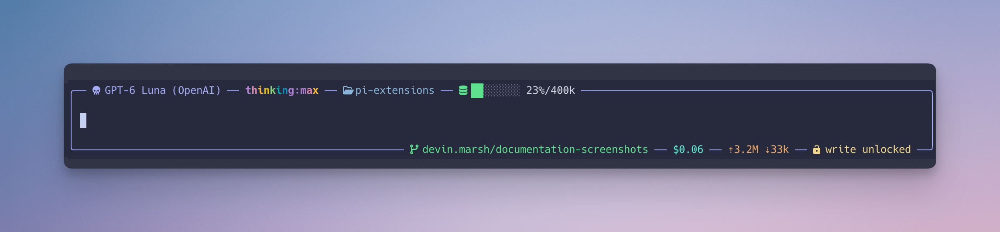

# context-footer

A [pi](https://github.com/earendil-works/pi-coding-agent) extension that draws
a continuous border around the prompt editor and sets session state into the
rule itself, inspired by
[`pi-powerline-footer`](https://github.com/nicobailon/pi-powerline-footer).



```text
╭── 󰚌 Claude Sonnet 5 ── thinking:high ──  pi-extensions ──  ░░░░░░░░ 5%/1.0M ── 󰓹 my-feature-work ──╮
│                                                                                                    │
│ what shape should the border take?                                                                 │
│                                                                                                    │
╰────────────────────────────────  devin.marsh/context-footer ── #4 ── ⇡47k ⇣5 ── 󰌿 write unlocked ──╯
```

The top run carries identity and context health; the bottom run carries the
rest of the session. Items are breaks in the line rather than a status bar
attached to it. A run too wide for the terminal is cut with `…` and the frame
still closes. The completion list and a scrolled input's `↑ N more` marker are
drawn inside the frame. Below 24 columns the layout falls back to two plain
footer rows, so nothing disappears.

## Configuration

Everything is set in `<agent dir>/pi-context-footer/config.json`.
`/context-footer reload` applies an edited file without restarting pi.

### Layout

Four regions, `topLeft`, `topRight`, `bottomLeft` and `bottomRight`, each list
their items in order. A region left out keeps its default; one given replaces
it. [`examples/`](examples/) has the default layout and a couple of variations.

```json
{
  "layout": {
    "bottomRight": ["branch", "tokens", { "status": "write-lock", "color": "warning" }]
  }
}
```

| Item | Shows |
|---|---|
| `model` | The model's name. |
| `thinking` | The thinking level, in the [shared scheme](../README.md#libthinking-colorsts). |
| `directory` | The working directory, or the repository's name and the directory below its root. |
| `context` | A gauge of context use and the context window. |
| `session-name` | The session's display name, anchored at the top-right corner. |
| `hostname` | The machine's name, anchored at the bottom-left corner. Off by default. |
| `branch` | The git branch. |
| `pull-request` | The branch's pull request number from `gh`, as a link. |
| `tokens` | Cache-inclusive input and output tokens across the session, including abandoned branches. |

`{ "status": "<key>" }` shows a status another extension publishes, and
`{ "remainingStatuses": true }` shows every published status no item names.
`/context-footer statuses` lists the statuses you can select. A status item
takes `maxWidth`, and either a `color` it is repainted in (the default) or
`"presentation": "producer"` to keep the producer's styling.

The default layout shows `pi-background-tasks`' `background-tasks` and
`pi-write-lock`'s `write-lock` statuses.

### Colors

`colors` overrides the color of anything the footer paints, by role. A value
is a theme color name, which follows theme switches, or a fixed color in any
form a pi theme accepts: `#rgb`, `#rrggbb`, `oklch(…)`, `okhsl(…)`, or a
0–255 index. Status items take the same values for `color`.

```json
{
  "colors": {
    "directory": "#87d7ff",
    "repo": "oklch(80% 0.12 300)",
    "hostname": "syntaxKeyword"
  }
}
```

| Role | Default |
|---|---|
| `frame` | `syntaxType` |
| `separator` (between items in the plain footer) | `borderMuted` |
| `notice` (`↑ N more`) | `dim` |
| `model` | `syntaxType` |
| `thinkingOff` | `dim` |
| `directory`, `repo` | `syntaxFunction`, `syntaxKeyword` |
| `context.ok`, `context.warning`, `context.critical` | `success`, `warning`, `error` |
| `context.empty`, `context.text` | `dim`, `text` |
| `sessionName`, `hostname` | `accent` |
| `branch`, `pullRequest`, `tokens` | `success`, `mdLink`, `syntaxNumber` |

In bash mode the frame takes pi's bash-mode color instead. The thinking label
uses the shared thinking scheme, except `off`, which uses `thinkingOff`: a
theme may make pi's own `thinkingOff` nearly invisible.

### Hostname

```json
{
  "hostname": {
    "show": true,
    "match": "^devbox-(.+)$",
    "nickname": "box $1",
    "nicknames": { "devbox-17.corp.example": "devbox" }
  }
}
```

- **`show`** turns the item on. `/context-footer host on|off` writes it.
- **`match`**, a case-insensitive regex, decides on its own when set: the item
  shows exactly when it matches the real hostname. One shared config can then
  show the name on remote machines and hide it on a laptop.
- **`nickname`** is a label expanded from `match`'s captures, with
  `String.prototype.replace` syntax (`$1`, `$<name>`, `$&`, `$$`).
- **`nicknames`** maps a hostname, or its first label, to a label. It wins over
  `nickname`.

`/context-footer host` re-reads these settings and reports what is shown and why.

### Status formatters

`statusFormatters` names a trusted JavaScript module, resolved beside
`config.json`, that rewrites selected statuses before they are drawn:

```js
export default {
  "example-work": (text) => text === "work ready" ? "ready" : undefined,
};
```

A formatter receives the sanitized text and returns a replacement, `""` to hide
it, or `undefined` to keep it. Published statuses and their other consumers are
untouched. The module runs with pi's permissions.

## Showing your extension's status

Publish it with `ctx.ui.setStatus(key, text)`; there is no footer API. It
appears once the owner adds `{ "status": "<key>" }` to the layout. The text is
shown on one line as published, so put any icon or freshness in it yourself.

## Usage

```text
/context-footer                    toggle the decoration
/context-footer on|off             enable or disable it
/context-footer reload             re-read config.json and the status formatters
/context-footer statuses           list the statuses that can be selected
/context-footer pad [full|none]    report or set a blank row above and below the input
/context-footer animate [on|off]   report or set the max thinking level's moving sheen
/context-footer host [on|off]      report the hostname item, or set its switch
```

`off` leaves the editor wrapper installed but inert, so an editor integration
installed after it keeps working, and hands the footer back to pi.

The rails are real characters, so copying across them copies them too; a
terminal's rectangular selection (⌥-drag in iTerm2, Terminal.app, and Ghostty)
takes only the text.

## Development

```bash
npm run test:context-footer             # unit tests and a fake pi host
python3 pi-context-footer/tui.test.py   # the real pi on PATH in a pty; needs pyte
```
