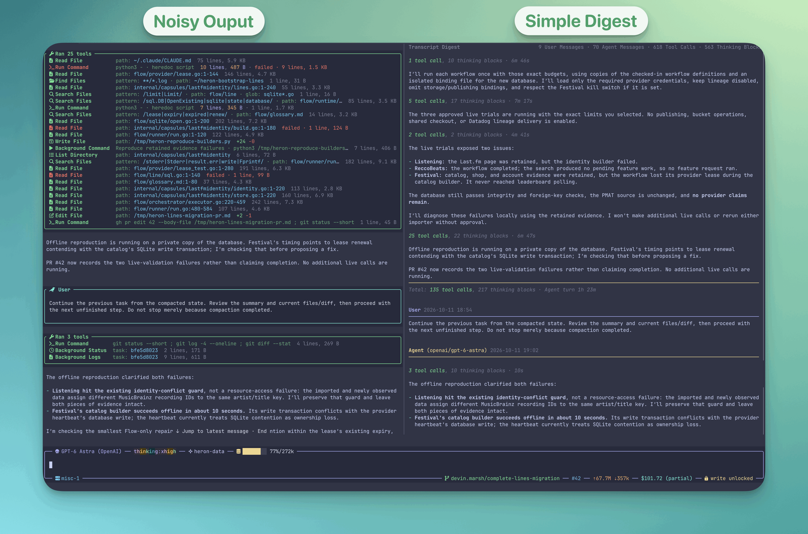

# pi-transcript-digest

A [pi](https://github.com/earendil-works/pi-coding-agent) extension for the **fullscreen TUI**. `/transcript-digest` toggles a two-column transcript: Pi's existing feed (including tool calls, output, and its normal scrolling) on the left, and a separately scrollable conversation on the right. The editor, status, widgets, and footer remain full-width.



## Try it

Link it with [`install.sh`](../README.md#install) from the repository root, then launch Pi from any directory. Fullscreen mode is the default from Pi 1.0.0; earlier versions need the flag:

```bash
pi --tui-mode fullscreen
```

Enter `/transcript-digest` to enable the split; enter it again to disable it. `/transcript-digest on|off|status` is also available. The toggle starts off, so loading the extension does not change the layout until you enable it.

The right pane renders user and agent text as Markdown using Pi's active theme, including headings, lists, links, tables, and syntax-highlighted code blocks. It shows the active session branch, updates as agent text streams, and represents image attachments as `[image]`. Its header shows the **Transcript Digest** title with counts of user messages, agent messages, tool calls, and thinking blocks right-aligned beside it, wrapping onto right-aligned rows below when the pane is narrow. Consecutive agent content shares one section until a user interaction, including steering, begins another. The header keeps the first agent message's model and timestamp; intervening activity counts include elapsed time between visible messages, preserving their sequence without repeating timestamps. A closing rule marks section totals and elapsed agent time, with user waiting time included at a handoff. Follow-ups queued before the agent finished have no user waiting time. The current section stays open while the agent runs. Questions the agent asks with `ask_user_question` appear in its section with their options, and the user's answers, notes, or decline form a User section that hands off like a message; the call still counts as a tool call. Other thinking text, tool details and results, and extension messages are omitted. It follows the latest message until you scroll. Scroll over either pane with the mouse or drag the right scrollbar. Use **Alt+K** to page up, **Alt+J** to page down, and **Alt+G** to return to the latest message. Pi's normal transcript keys still scroll the left pane.

Below 36 terminal columns, the right pane is hidden; it reappears on resize. Switching away from fullscreen mode via `/settings` detaches the split; toggle it on again after returning to fullscreen.

## Compatibility

Fullscreen mode is required; it is Pi's default from 1.0.0. The split is available only on supported Pi transcript layouts. Pi 0.85.1 and 0.87.1 are tested; Pi 0.84.1 lacks the mouse and scrollbar APIs used here.
